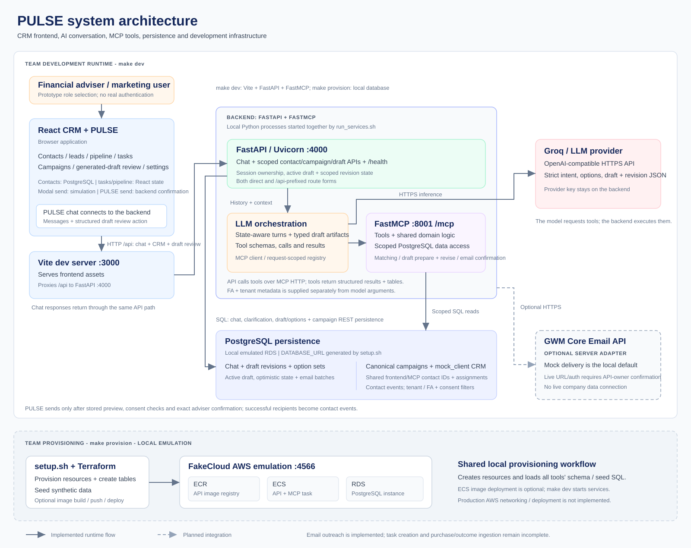

# PULSE CRM

BT4103 Capstone Project (Team 4). PULSE combines an adviser CRM with a persistent
AI assistant backed by FastAPI, FastMCP, PostgreSQL and Groq.

## Team setup and development workflow

Use the same workflow for every MCP feature:

```text
make bootstrap -> configure the Groq key -> make provision -> make dev
```

`make provision` runs `backend/setup.sh`: it starts the local AWS emulator,
provisions Terraform resources, creates PostgreSQL tables and loads synthetic
seed data. `make dev` starts Vite, FastAPI and FastMCP together. These are local
development services, not a deployment to real AWS.

Demonstrate features through **http://localhost:3000**. Register tools in the
existing MCP server and integrate them with the existing chat flow. Do not create
separate feature demo programs or change `backend/run_services.sh` without team
agreement.

### Prerequisites

Run Make commands from the repository root in a Bash environment on macOS or
Linux. On Windows, use a user Linux distribution under WSL 2; regular PowerShell
and Docker Desktop's internal `docker-desktop` distribution are not the required
development environment.

You need:

- Docker Desktop / a running Docker engine.
- Node.js 22.12 or newer from a supported release line, and npm.
- Python 3.11 or newer, managed through [uv](https://docs.astral.sh/uv/getting-started/installation/).
- Make and Bash.
- Terraform, PostgreSQL client tools (`psql`), Netcat (`nc`) and AWS CLI (`aws`).
- [FakeCloud](https://fakecloud.dev/docs/getting-started/install/), installed
  separately as the `fakecloud` executable required by `setup.sh`.

The `localstack` Python dependency does not install FakeCloud. Install FakeCloud
using the official installer below; no custom wrapper or alias is required.

Check the commands inside the same Bash environment you will use for Make:

```bash
command -v docker node npm uv make bash terraform psql nc aws fakecloud
docker info
node --version
```

### Windows: prepare WSL first

In Administrator PowerShell, install a user distribution if you do not already
have one:

```powershell
wsl --install -d Ubuntu
```

Follow the installer, restart Windows if requested, then launch Ubuntu and create
your Linux username/password. See [Microsoft's WSL installation guide](https://learn.microsoft.com/en-us/windows/wsl/install).
Enable Docker Desktop's WSL integration for that distribution and check
`docker info` in Ubuntu.

Use a Linux checkout and install the prerequisites inside that distribution.
Windows installations of Python, Node and Terraform do not establish a complete
Linux development environment. Keep Linux `.venv` and `node_modules` separate
from Windows installations. On Ubuntu, the basic build/database utilities can be
installed with:

```bash
sudo apt update
sudo apt install make git curl ca-certificates postgresql-client netcat-openbsd unzip
```

Install the required Node version, uv, Terraform and AWS CLI for Linux. Use
the official installation guides for [nvm / Node.js](https://github.com/nvm-sh/nvm#installing-and-updating),
[uv](https://docs.astral.sh/uv/getting-started/installation/),
[Terraform](https://developer.hashicorp.com/terraform/install) and
[AWS CLI](https://docs.aws.amazon.com/cli/latest/userguide/getting-started-install.html).

If you copy an existing Windows working tree into Ubuntu, keep the Linux
`.venv` and `node_modules` separate and run `git config core.autocrlf input`
in that checkout so Windows line endings do not create unrelated Git changes.
Treat the Ubuntu checkout as your working copy; edits do not automatically
synchronize with the Windows copy.

### Install FakeCloud

In macOS/Linux/Ubuntu Bash, run the [official FakeCloud installer](https://fakecloud.dev/docs/getting-started/install/):

```bash
curl -fsSL https://fakecloud.dev/install.sh | bash
command -v fakecloud
```

The check should print the executable path. macOS developers using Homebrew
can use `brew install fakecloud` instead. Keep Docker running: FakeCloud uses
containers for stateful services such as PostgreSQL/RDS. `make provision`
starts the emulator automatically; no separate `fakecloud` startup terminal
is needed. Local provisioning and the schema/seed scripts have been verified
with FakeCloud 0.50.0 on Ubuntu under WSL 2.

### 1. Bootstrap the checkout

Open Docker Desktop and wait until its engine is running. From the repository
root in your Bash environment:

```bash
UV_PYTHON=3.11 make bootstrap
make doctor
```

This installs the backend and frontend dependencies and creates `backend/.env`
only if it does not already exist. Python 3.11 matches the backend Docker image.
`make doctor` checks application prerequisites; the provisioning script checks
its own infrastructure commands separately.

### 2. Configure the AI provider

Edit `backend/.env` locally and replace the placeholder Groq key:

```dotenv
GROQ_API_KEY=your_actual_groq_api_key
MCP_SERVER_URL=http://127.0.0.1:8001/mcp
```

Keep the remaining example settings unless the team agrees to change them.
Never commit `.env`, provider keys or generated database addresses. The provider
key belongs in the backend, not in `VITE_*` frontend settings.

Do not retain `pulse-postgres:5432` as the database address for this workflow.
That hostname belongs to the earlier direct Docker setup. The next step writes
the correct emulator-provisioned database address into `backend/.env`.

### 3. Provision the database and mock data

With Docker running and FakeCloud installed, run from the repository root:

```bash
make provision
```

`backend/setup.sh` provisions the local infrastructure, updates `DATABASE_URL`,
then applies these files in order:

1. `backend/tables/create_campaign_chat_sessions.sql`
2. `backend/tables/create_mock_campaign_tables.sql`
3. `backend/tables/seed_mock_campaign_data.sql`
4. `backend/tables/create_mock_campaign_engagement.sql`
5. `backend/tables/create_mock_campaign_contact_event.sql`
6. `backend/tables/seed_mock_campaign_contact_events.sql`

The mock scripts create campaign, adviser-access and client tables and seed two
campaigns and 14 synthetic clients. The contact-event table stores synthetic
outreach dates for those campaigns and the assigned adviser; campaign names come
from `mock_campaign`, not duplicated contact rows. Each row is one contact, so
repeat contacts can be distinguished from a client's first campaign contact.
Every teammate loads the same checked-in SQL into their own local database;
database edits are not automatically shared.

The scripts are repeatable. Seed inserts preserve existing records using
`ON CONFLICT DO NOTHING`; use an explicit migration/update script for changes
to existing columns or records. Stop and fix any provisioning error before
starting the app.

### 4. Start the complete application

From the repository root:

```bash
make dev
```

Keep the terminal running. The Makefile uses the backend virtual environment and
runs the existing `backend/run_services.sh` plus `npm run dev`:

| Service | Address / role |
| --- | --- |
| Vite / React | `http://localhost:3000`; serves the CRM and PULSE |
| FastAPI | `http://localhost:4000`; chat routes and AI orchestration |
| FastMCP | `http://localhost:8001/mcp`; shared tool server |
| PostgreSQL | Emulator-provisioned address from `make provision` |

No separate MCP or API startup command is needed. Press **Ctrl+C** to stop the
development services. Provisioning/database resources have a separate lifecycle;
stopping `make dev` does not delete database records. After first-time setup,
start Docker and the configured local emulator/database, then run `make dev`.
Rerun `make provision` when new schema/seed scripts are added or provisioning is
needed, and restart `make dev` afterward to reload configuration.

If moving from the previous direct Docker workflow, stop the old `pulse-api`
container and the separately running frontend before `make dev`, so ports 4000
and 3000 are available. Your old `pulse-postgres` database is separate; its chats
and local edits are not migrated automatically. You can keep it stopped without
deleting its volume. Do not run both backend startup workflows simultaneously.

### Everyday startup on Windows

Open Docker Desktop and wait for the engine to start. In PowerShell, enter
your Ubuntu environment:

```powershell
wsl -d Ubuntu
```

In Ubuntu, run these commands separately. This example assumes your checkout
is at `~/capstone-group-4`:

```bash
cd ~/capstone-group-4
make provision
make dev
```

Wait for provisioning to succeed before starting development services. You
can skip `make provision` if FakeCloud and the provisioned database are already
running and no SQL scripts changed. Open http://localhost:3000 and keep the
terminal running. Press Ctrl+C to stop the application. Tool installations
are one-time setup; rerun `make bootstrap` when project dependencies change.

### 5. Verify the interim presentation flow

Open http://localhost:3000, choose **Financial Advisor** (the Steven Raynaldi demo
account), and open **Campaigns > Legacy Protection Refresh**. Open PULSE, click
**Ask for recommended clients**, then send the question.

For untouched seed records, expect:

| Campaign | Evaluated | Matches | Incomplete | Excluded |
| --- | ---: | --- | ---: | ---: |
| Legacy Protection Refresh (`camp-1`) | 12 | A, B, C, L (4) | 2 | 6 |
| First Home Starter Bundle (`camp-2`) | 12 | F, G, H (3) | 2 | 7 |

The matcher uses the fixed demo date **2026-08-26**. The backend's 14 synthetic
clients are separate from the frontend CRM's 75 seed contacts. Browser-created
campaigns are not inserted into the mock database. Recommendations explain
criteria matches; they do not rank suitability or authorize outreach.

## Adding another MCP feature

1. Put synthetic schema/migration/seed SQL in `backend/tables/`.
2. Add the SQL filename to the ordered `table_script` loop in `backend/setup.sh`.
   Apply schema before its dependent seed data. Do not change service startup.
3. Register the tool in `backend/mcp/server.py`; keep matching, storage and other
   implementation logic in importable modules. Supply adviser/tenant context
   server-side and enforce ownership at data-access boundaries.
4. Integrate the feature into the shared frontend and demonstrate it at port 3000.
5. Add behavior tests and update the API/architecture documentation as needed.

## Architecture

```text
Browser -> React / Vite :3000 -> /api proxy -> FastAPI :4000
                                              -> Groq (HTTPS)
                                              -> FastMCP :8001/mcp -> PostgreSQL
                                              -> chat storage -> PostgreSQL
make provision -> setup.sh -> local AWS emulator + Terraform -> database / SQL
make dev -> run_services.sh (FastAPI + MCP) and npm run dev (Vite)
```



[Open the system diagram](backend/docs/Architecture.svg). The PNG is an older
export. `frontend/` owns CRM browser state; `backend/` owns chat persistence,
MCP tools and the separate synthetic recommendation dataset. `docs/` and
`gwm_api/` contain local company references, not runnable integrations.

## Make commands and verification

See [Makefile](Makefile) for the full commands. `make backend-dev` runs both
FastAPI and MCP; `make frontend-dev` runs only Vite. `make verify` runs backend
tests, frontend checking/build, Python compilation, shell syntax and Terraform
formatting. Focused chat rendering checks also run from `frontend/`:

```bash
npm run test:chat
```

Backend tests mock the model provider and make no Groq calls. PostgreSQL
integration tests are opt-in through `PULSE_TEST_DATABASE_URL`; they use isolated
temporary schemas and do not alter public demo tables. There is no complete
frontend component/end-to-end suite.

## Troubleshooting and optional infrastructure

- **Missing `fakecloud`:** install it using the official installer above in the
  same macOS/Linux/WSL environment as Make. Run `command -v fakecloud`; if no
  path appears, follow the installer's PATH instructions or reopen the terminal.
  Installing the LocalStack Python dependency alone does not provide FakeCloud.
- **Missing commands / `.venv/bin` paths:** use macOS/Linux/WSL Bash and install
  prerequisites there. Run `make bootstrap` before `make dev`.
- **Port conflicts:** stop previous API/frontend instances before `make dev`.
- **Database errors:** ensure provisioning succeeded and restart the backend
  after `DATABASE_URL` changes. Never copy a company production hostname.
- **Provider errors:** `/health` reports whether a key is present, not whether it
  is valid. Restart after editing `.env`; check authentication/connectivity and
  provider rate limits if requests fail.

The emulated ECS image deployment is optional and is not needed for the interim
frontend demonstration. It is enabled through `DEPLOY_FAKECLOUD_ECS=1` when running
`make provision`. The checked-in infrastructure targets localhost, not real AWS.
Authentication, company API adapters, backend consent/outreach/follow-up/outcome
integration and production infrastructure remain future work.

See [backend documentation](backend/README.md), [frontend documentation](frontend/README.md),
[API contract](backend/docs/api_contract.md) and [recommendation assumptions](backend/docs/campaign_recommendations.md).
