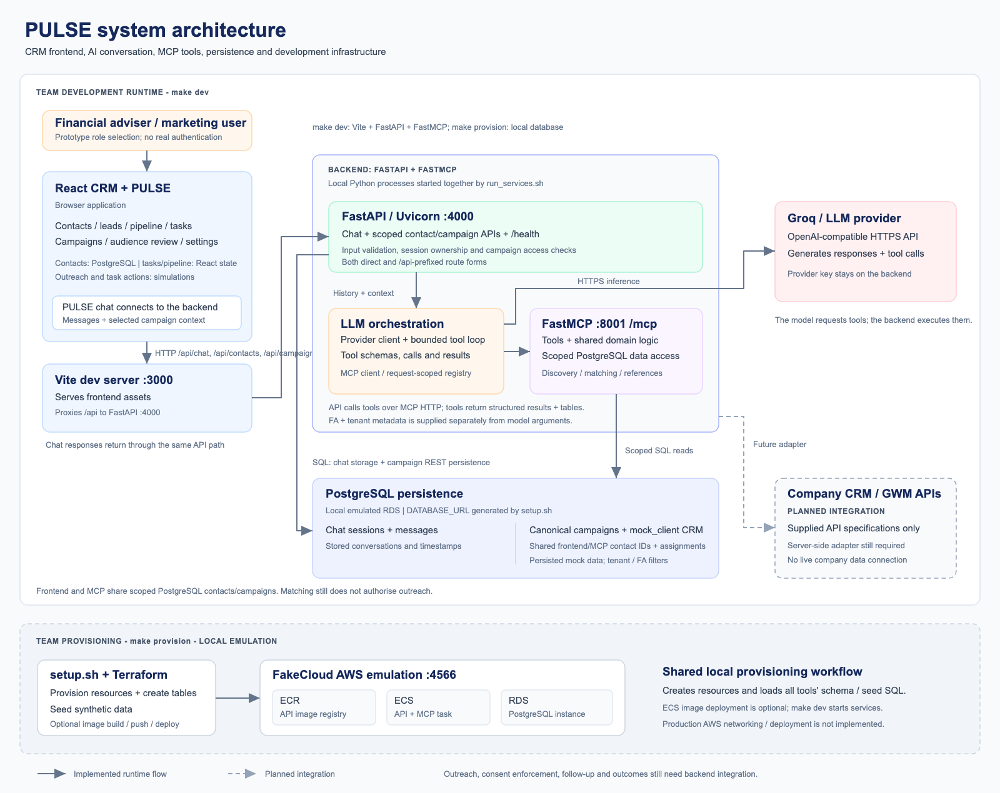

# PULSE CRM

BT4103 Capstone Project (Team 4). PULSE combines a MyWealth-style adviser CRM
with a persistent AI assistant backed by FastAPI, PostgreSQL, and Groq's
OpenAI-compatible API.

## Architecture

```text
Browser
  └─ React + Vite (:3000)
       └─ /api development proxy
            └─ FastAPI (:4000)
                 ├─ PostgreSQL chat storage (local Docker/FakeCloud)
                 ├─ bounded in-process tool loop
                 └─ Groq OpenAI-compatible API (HTTPS)
```



- `frontend/` contains the React 19, TypeScript, Vite, and Tailwind CRM. The
  floating PULSE panel calls `/api/chat/...`; the other CRM modules currently
  use synthetic seed data and React state.
- `backend/` contains the FastAPI routes, PostgreSQL data access, LLM client,
  bounded tool orchestration, shared tool implementations, FastMCP prototype,
  SQL, tests, and local FakeCloud/Terraform configuration.
- `backend/app/tools/` is used directly by the API's LLM loop. FastMCP exposes
  the same implementations over stdio for development, but it is not a
  deployed service and is not called by FastAPI over the network.
- `docs/` and `gwm_api/` contain handling guidance for locally supplied company
  reference material. Confidential source files are intentionally git-ignored.

Chat sessions and successful user/assistant exchanges are stored locally in
PostgreSQL tables `campaign_chat_sessions` and `campaign_chat_messages`.

## Prerequisites

Use macOS with the following installed:

- Docker Desktop (the Docker CLI alone is not sufficient)
- Node.js 20 LTS and npm
- Python 3.11 or newer
- [`uv`](https://docs.astral.sh/uv/) for Python environments and dependencies
- FakeCloud
- Terraform
- PostgreSQL command-line tools (`psql`)
- AWS CLI
- Netcat (`nc`, included with macOS)
- Make (included with Xcode Command Line Tools)

One Homebrew setup is:

```bash
brew install node@20 uv fakecloud awscli libpq
brew tap hashicorp/tap
brew install hashicorp/tap/terraform
```

`node@20` and `libpq` may be keg-only. Follow the PATH instructions printed by
Homebrew so that both `node` and `psql` are found in a new terminal.

Open Docker Desktop and wait for its engine to become ready:

```bash
open -a Docker
docker info
```

## First-time setup

Run these commands from the repository root, not from `backend/`:

```bash
make bootstrap
make doctor
```

`make bootstrap` creates the Python virtual environment with `uv`, installs the
locked backend and frontend dependencies, and creates `backend/.env` from the
example if it does not already exist.

Add your own Groq key to `backend/.env`:

```dotenv
GROQ_API_KEY=your-key-here
```

Never commit or share `backend/.env`. Provider credentials stay in the backend;
do not put them in a `VITE_*` variable because Vite exposes those values to the
browser. `make provision` will replace the example `DATABASE_URL` with the
generated local PostgreSQL address.

With Docker Desktop running, provision the local database:

```bash
make provision
```

Then start both applications:

```bash
make dev
```

Open http://localhost:3000, choose the Financial Advisor role, and click the
floating PULSE button. Press `Ctrl-C` in the terminal running `make dev` to stop
both development servers.

## What `setup.sh` does

`make provision` runs `backend/setup.sh`. The script requires these commands to
be on PATH:

```text
docker  fakecloud  terraform  nc  psql  aws
```

The normal setup path:

1. Loads the ignored `backend/.env` without printing its secrets.
2. Starts FakeCloud on `127.0.0.1:4566` if it is not already running.
3. Runs `terraform init` and `terraform apply` against FakeCloud's local AWS
   endpoints.
4. Creates a local PostgreSQL container and reads its generated host port.
5. Writes the generated `DATABASE_URL` back to `backend/.env`.
6. Applies `backend/tables/create_campaign_chat_sessions.sql` with `psql`.
7. Stops after reporting that the local chat database is ready.

The SQL is idempotent, so provisioning can be rerun when the local database has
been removed or recreated. This is development infrastructure: deleting the
Docker/FakeCloud database may delete locally stored chats.

### Optional emulated ECS deployment

The frontend does not need an ECS container. `make dev` runs FastAPI directly
from the `uv` environment. To additionally exercise the emulated container
deployment path:

```bash
cd backend
DEPLOY_FAKECLOUD_ECS=1 ./setup.sh
```

This optional path builds the backend image, pushes it to FakeCloud's emulated
ECR, and reapplies Terraform. Some Docker runtimes require extra insecure-
registry configuration for FakeCloud's local HTTP registry. Do not use this
path for routine frontend/backend development.

## Make commands

| Command | Purpose |
| --- | --- |
| `make help` | List the supported project commands. |
| `make doctor` | Check Node, npm, `uv`, installed dependencies, and `.env`. |
| `make configure` | Create `backend/.env` without overwriting an existing one. |
| `make install` | Install locked backend and frontend dependencies. |
| `make bootstrap` | Run installation and create the local environment file. |
| `make provision` | Provision FakeCloud resources and initialize PostgreSQL. |
| `make dev` | Run FastAPI on `:4000` and Vite on `:3000`. |
| `make backend-dev` | Run only FastAPI. |
| `make frontend-dev` | Run only Vite. |
| `make test` | Run backend tests and the frontend TypeScript check. |
| `make frontend-build` | Create the production frontend bundle. |
| `make verify` | Run tests, build, Python compilation, shell validation, and Terraform formatting checks. |

## Python and `uv`

The backend dependency sources of truth are `backend/pyproject.toml` and
`backend/uv.lock`. Do not manually populate the environment with `pip`.

Run backend commands from `backend/` through `uv`:

```bash
uv sync --dev
uv run pytest
uv run uvicorn app.main:app --host 0.0.0.0 --port 4000 --reload
uv run python mcp/server.py
```

The MCP command starts the independent stdio prototype; it is not needed for
the floating chat panel.

## Manual development commands

If the Makefile is unavailable, start the backend in one terminal:

```bash
cd backend
uv sync --dev
uv run uvicorn app.main:app --host 0.0.0.0 --port 4000 --reload
```

Start the frontend in another terminal:

```bash
cd frontend
npm ci
npm run dev
```

Vite forwards `/api` requests to `http://localhost:4000`. For a separately
hosted backend, set `VITE_API_BASE_URL` to its public origin; never put backend
credentials in the frontend environment.

## Verification

The complete project check is:

```bash
make verify
```

Equivalent component commands are:

```bash
cd backend
uv run pytest

cd ../frontend
npm run lint
npm run build

cd ..
python3 -m compileall -q backend/app backend/mcp
bash -n backend/setup.sh
terraform -chdir=backend/terraform fmt -check
```

Backend tests mock Groq and do not make provider network calls. No automated
frontend test runner is configured yet; `npm run lint` performs strict
TypeScript checking.

## Troubleshooting

### `Required command not found`

Install the command named by `setup.sh`, open a new terminal, and confirm it is
on PATH with `command -v <name>`. In particular, Homebrew's `libpq` installation
may require a PATH update before `psql` is visible.

### Docker connection errors

Open Docker Desktop, wait for it to report that the engine is running, then
confirm:

```bash
docker info
```

### PULSE reports that chat storage is unavailable

Check that the local database container is running:

```bash
docker ps
```

Then reprovision and restart the application:

```bash
make provision
make dev
```

`setup.sh` writes a generated port into `backend/.env`, so restart FastAPI after
reprovisioning to reload `DATABASE_URL`.

### Groq configuration or provider errors

Check the backend health response:

```bash
curl http://localhost:4000/health
```

`llm_configured` should be `true`. A `429` means the provider rate-limited the
request; `502` indicates provider authentication/connectivity/response failure;
`504` indicates a provider timeout.

### Ports already in use

Check which process owns the development ports:

```bash
lsof -nP -iTCP:3000 -sTCP:LISTEN
lsof -nP -iTCP:4000 -sTCP:LISTEN
```

## Current limitations

- Adviser role selection and `fa_id` are prototype mechanisms, not real
  authentication or authorization.
- The campaign/database search tool is still a labelled placeholder; real CRM
  campaign and contact data are not yet available to Groq.
- Most CRM state is synthetic frontend data and resets on refresh. Only PULSE
  chat sessions and successful exchanges are persisted by the backend.
- FakeCloud/Terraform is a local demonstration stack, not a production AWS
  design.

See `frontend/README.md`, `backend/README.md`,
`backend/docs/api_contract.md`, and the nearest `AGENTS.md` for more detail.
